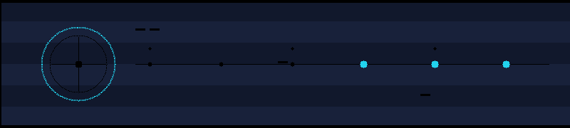
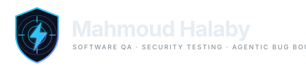

 

# Mahmoud Halaby

**Software QA Engineer · Security Tester · Agentic Bug-Bounty Builder**

<a href="#about">About</a> • <a href="#what-i-do">What I Do</a> • <a href="#experience">Experience</a> • <a href="#projects">Projects</a> • <a href="#contact">Contact</a>

 

 

---

> [!NOTE]
> I'm a **QA and security tester with 5+ years** turning software quality into a
> security discipline. I don't just find bugs — I hunt for the ones that matter:
> **business-logic flaws, information disclosure, and API weaknesses** with real
> impact. Lately I've been building **agentic tooling for bug bounty** so mapping,
> testing, and proof happen with repeatable rigor instead of ad-hoc poking.

**Currently**
- 🛠️ Building `shadowstike` — an agentic bug-bounty orchestration engine
- 🔍 Hunting business-logic and price-manipulation flaws in production systems
- 🧪 Testing web + mobile (iOS/Android) APIs and client behavior

**Ask me about**
- Finding business-logic bugs that scanners miss
- Root-cause analysis of live incidents
- Building QA自动化 that catches security regressions
- Turning a manual test process into an agentic workflow

| 🧪 QA & Security | 🐞 Bugs Found | 🔥 Critical Logic / Security | 🏢 Teams | 📱 Platforms |
|:---:|:---:|:---:|:---:|:---:|
| **5+ years** | **1,500+** | **700+** | **3** | **iOS · Android** |

---

<table>
  <tr>
    <td width="50%" valign="top">

### 🔐 Security Testing
- OWASP Top 10 methodology
- Business-logic bug analysis
- Price manipulation & info disclosure
- Request/response manipulation

### 🌐 API Testing
- Endpoint behavior validation
- Data-flow verification
- Postman + Burp Suite

    </td>
    <td width="50%" valign="top">

### 📱 Mobile Testing
- Real & virtual iOS / Android devices
- Proxyman network interception
- Logcat & Instabug diagnostics

### ⚙️ Automation & Ops
- Jira · TestOps · DBeaver / MySQL
- Kubernetes health via OpenLens
- Agile / Scrum delivery

    </td>
  </tr>
</table>

### Skill proficiency

| Area | Level |
|---|---|
| Manual / Functional / Regression / Smoke / UAT | ████████████████████ 95% |
| Security & Business-Logic Testing | █████████████████░░ 85% |
| API Testing (Postman / Burp / Proxyman) | ████████████████░░░░ 80% |
| Mobile Testing (iOS / Android) | ███████████████░░░░░ 75% |
| Defect Lifecycle & RCA | █████████████████░░ 85% |
| SQL / Database Validation | ████████████░░░░░░░░ 60% |

---

### 🟦 Snoonu — Senior QA & Security Tester
**02/2026 – Present**

- Identified **critical business-logic vulnerabilities** — price manipulation and information disclosure — using OWASP Top 10 principles.
- Investigated high-priority **live incidents** and performed **Root Cause Analysis (RCA)** to fix underlying issues and safeguard data.
- Managed technical configurations across multiple **staging and production** environments for smooth releases.
- Collaborated with overlapping product teams on cross-functional features and technical dependencies.
- Authored comprehensive test suites, cases, and detailed bug reports with replication steps and logs.
- Executed regular smoke, functional, and regression cycles to maintain high application quality.

### 🟩 inDrive — Software QA Engineer

- Tested on **real and virtual iOS / Android** devices for consistent performance.
- Used **Proxyman, Postman, and Burp Suite** for network interception, API testing, and data-integrity validation.
- Monitored app health with **Logcat** and **Instabug** crash reports to find root causes.
- Validated backend data integrity by querying **MySQL** with **DBeaver**.
- Managed the full defect lifecycle in **Jira** — documentation → prioritization → resolution.
- Developed and updated test cases in **TestOps** to optimize coverage.
- Monitored service and container health in **Kubernetes** with **OpenLens**.
- Ran **pre-release** and **post-deployment smoke** tests; partnered on **UAT** for business requirements.

### 🟨 Integrated Solutions for Ports (ISFP) — Software QA
**10/2021 – 2024** · _Project: Civil Courts Automation Project, Egyptian Ministry of Justice_

- Analyzed requirements and built comprehensive test cases for a complex court and case-management system.
- Found and reported **1,500+ bugs — including 700 critical business and security-logic issues** in Jira.
- Conducted backend **API testing with Postman** to validate data flow and endpoint behavior.
- Performed regression testing after updates to prevent new changes from breaking existing features.
- Reviewed **Figma** designs early to align UI/UX and system logic with requirements.
- Authored system manuals with **Dr. Explain** and release notes for technical and non-technical stakeholders.

---

### 🤖 [shadowstike](https://github.com/MahmoudHalaby/shadowstike) — Agentic Bug-Bounty Orchestration

A coordinator-driven security-testing engine built on OpenCode 2. One agent plans and
adjudicates; focused subagents do the testing; nothing becomes a finding without proof.

- **8 specialized solvers** — recon, inject, authz, logic, surface, mobile, verifier, reporter
- **74 class playbooks** and **302 local pattern rules** across 18 packs
- Coverage-ledger grid (endpoint × class × principal) with reason codes for every cell
- Money-path chain synthesis, abort-safe resume, scope guard, and Burp-routed requests

---

### 🎓 Education

**BSc in Engineering — Computers & Systems Department**
Kafr Elsheikh University · Kafr Elsheikh, Egypt · **2016 – 2021**

### 🧰 Toolbox

### 🗣️ Languages

- **Arabic** — Native
- **English** — Professional working proficiency

---

  

_If you're reaching out about a role or a collaboration, a short note about what you're building helps._

 

